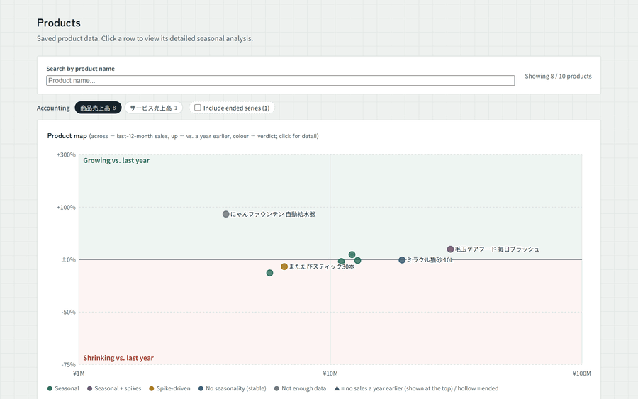
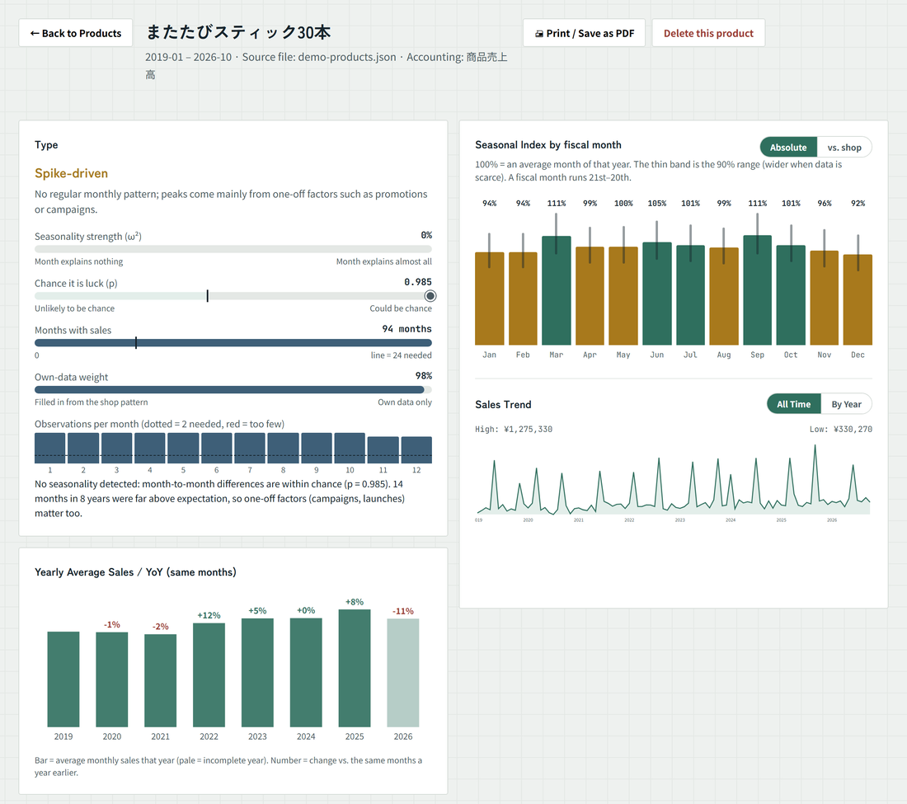
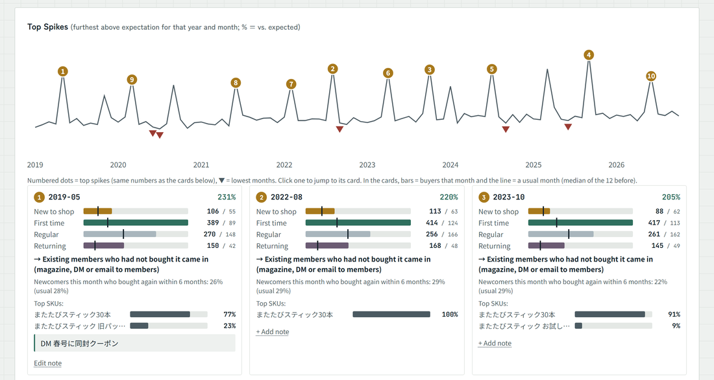
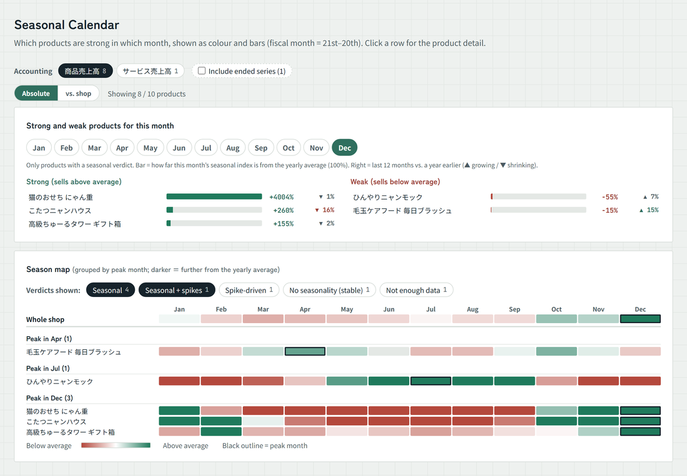

# Seasonal Analyzer — 商品別 季節性・トレンド分析

[](https://github.com/coolcatplayground/seasonal-analyzer/actions/workflows/verify.yml)

### When a product sells well, is it the season, or something we did?

A web app that answers that question for every product in a catalogue at once. Load the monthly sales, and it gives each product a verdict (seasonal, seasonal with spikes, spike-driven, stable, or not enough data yet), lays every product's year out side by side in one calendar, and explains each spike by **who** bought: new customers, members reached by a mailing, or the usual buyers buying more.

**[▶ Open the live demo](https://coolcatplayground.github.io/seasonal-analyzer/?demo)** — it opens with a fictional cat-supply store already loaded. No sign-in, nothing to install. Japanese and English, desktop and phone.



---

## Field notes: the creature in the wild

A colleague and I were doing this by hand. Export a product's monthly numbers, squint at the peaks, argue about whether December was the gift season or the campaign we ran, then copy the verdict into a master spreadsheet. It worked for a handful of products and fell apart at hundreds. Worse, two people looking at the same chart would reach different conclusions depending on which year caught their eye.

The answer matters more than it sounds:

- A **seasonal** product should be **stocked** against the calendar. Its peak arrives whether you do anything or not.
- A **spike-driven** product should be **scheduled**. Its good months are the ones you choose.

Mix them up, and you either buy stock for a "peak" that was really a promotion, or wait for a season that was never coming on its own.

## What it does

**A verdict for every product.** Each product gets one of five verdicts: 季節性あり (seasonal), 季節性＋スパイク (seasonal + spikes), スパイク主導 (spike-driven), 季節性なし（安定） (stable) or データ不足 (not enough data). Next to it: how strong the season is, and how likely the pattern is to be luck.

**It admits when it isn't sure.** A product with less than two years of history gets no verdict at all. Until then, it borrows the shape of the shop's overall season, and the page shows how much of its estimate is its own data and how much is borrowed.



**Spikes come with a suspect, and the buyers to back it up.** For each unusual month the app compares the buyers with the twelve months before and names the pattern:

- **members reached**: existing members who had never bought the product (a magazine, DM or email)
- **acquisition**: customers new to the shop (ads, marketplaces)
- **usual buyers buying more**: a campaign to current buyers, or stocking up
- **bigger baskets**: about the same people, each spending more



Every month has a note field, so once someone learns the real reason, it gets written down and stays there. The **メモ** view collects every note across every product, and its by-month view lights up months where several products have notes: usually a shop-wide campaign.

**Buyers over time.** Each product's buyers per month are split into new to shop, first time for this product, regular and returning, with the share of newcomers who came back within six months. The app warns when the buyer base is shrinking or when newcomers have stopped coming back.

**The season calendar (季節カレンダー).** Every product's twelve months in one colour-coded grid, each product's best month starred. Sort by any month, filter like a spreadsheet, or switch to "against the shop" to see which products peak harder than the shop already does.



**Momentum (勢い).** The last 3, 6 or 12 months against what the product's usual path predicted. Over 100% means it's selling better than its season explains.

**Order channels (受注方法).** Sales by channel (web store, marketplaces, phone, fax and post, in store, classes), each channel's own season, and which products grew or shrank inside a channel. A filter in the top bar runs every page on one channel's sales.

**Inside a product.** SKU breakdown, with each spike listing the SKUs that made it. Tick SKUs and the whole page recalculates on just those.

**Also:** a 期間 switch (all years, last 5, last 3), so a pattern that changed shows as it is now; a 数値 / ビジュアル switch that swaps tables for charts on the same figures; a print view for a one-product handout; and re-uploads that merge by month instead of overwriting.

## Method: how a verdict is reached

The first version divided each month by its year's average and measured how much of the variation the month explained. On short histories that method found a "season" in almost anything, so it was replaced:

1. **Model.** For each product, `log(sales) = year effect + month effect + noise`. The year effects absorb growth and partial years; the log makes "+50%" mean the same for a small product and a large one.
2. **Is it real?** An F test for the month effect, with the p-value from a **permutation test**: shuffle the month labels inside each year 199 times and see how often chance does as well. Seasonal if p < 0.05.
3. **How strong?** ω² (omega squared), a version of η² corrected for the bias that makes short series look seasonal.
4. **Enough data?** No verdict below 24 months with sales, or if any month has been seen fewer than twice.
5. **Short histories borrow strength.** Each month's estimate is pulled toward the shop-wide pattern, more strongly the less data the product has (empirical Bayes shrinkage). The page shows the weight and a 90% band.
6. **Spikes.** Months far above what the model expected for that year and month, by a robust z-score. Half a spike or more per year counts as "spiky".

The spike diagnosis is a correlation, so it's labelled as a hypothesis and paired with a note field for the real answer.

The method comes from the seasonality analysis my colleague and I were already running in a spreadsheet; the app that automates it was built with generative AI under my direction.

## Specimens in the demo greenhouse

The real data is confidential, so the demo is a fictional cat-supply store: ten series, January 2019 to October 2026, generated in the browser. They were picked to give every verdict and every feature something to show:

| Series | What it is | Verdict |
|---|---|---|
| 猫のおせち にゃん重 | New Year feast, for cats | Seasonal |
| ハロウィン仮装 かぼちゃニャン | Halloween costume (discontinued) | Seasonal |
| ひんやりニャンモック | Cooling hammock | Seasonal |
| こたつニャンハウス | Heated dome | Seasonal |
| 高級ちゅーるタワー ギフト箱 | Premium gift tower | Seasonal |
| 毛玉ケアフード 毎日ブラッシュ | Hairball care food | Seasonal + spikes |
| またたびスティック30本 | Matatabi sticks | Spike-driven |
| ミラクル猫砂 10L | Litter | Stable |
| にゃんファウンテン 自動給水器 | Water fountain, launched Feb 2025 | Not enough data |
| しつけ教室チケット | Training class tickets (a service, so a second 会計区分) | Seasonal |

A few of them are there on purpose:

- **またたびスティック** sells steadily, with fourteen DM and magazine promotions scattered across eleven different months. The buyer breakdown names every one of its top ten spikes "members reached", and four of them carry notes saying which mailing it was.
- **ミラクル猫砂** is the honest trap. It wobbles enough month to month to look like a pattern on a chart; the permutation test says it's luck (p = 0.74).
- **ちゅーるタワー** has a bump every February: 猫の日 (2/22) gift boxes. In the spike list those Februaries come out as "bigger baskets", not more people, and its marketplace share has grown fastest of any series (22% → 45%).
- **にゃんファウンテン** is too young for a verdict, so it borrows the shop's season, and the 12-month view of 勢い tags it 新 (new).
- **こたつニャンハウス** is shrinking and this autumn is running well under its usual path, so it sits at the bottom of 勢い.
- **ハロウィン仮装** was discontinued in 2025, so it only appears when "show ended series" is ticked.

Two products also come as real Excel files in [`samples/`](samples). Drag them onto the upload area to try the .xlsx path.

## What it eats

**One product per .xlsx file.** The **sheet name becomes the product name**. The columns can be in any order, but the headers must match exactly:

| 月別推移 | 売上金額 | 購入個数 | 購入件数 | 総顧客数 | 新規顧客数 | 既存顧客数 |
|---|---|---|---|---|---|---|
| 25_04 | 1294060 | 223 | 179 | 121 | 36 | 85 |

This is exactly what my [basket analysis tool](https://github.com/coolcatplayground/basket-sales-analysis) exports. The two tools form a small food chain: one pulls monthly figures out of the company database, the other works out what their shape means.

**Or every product at once, as `products.json`.** The monthly roll-up writes one file with every series, its SKUs, buyer types and order channels. The demo is built in the same shape and goes through the same import path (see `js/db.js` for the fields).

## Running it

Open the live demo, or serve the folder locally:

```bash
python3 -m http.server 8000
```

There's no build step and no server-side code. Uploaded data is stored in the browser's IndexedDB and never leaves the device; nothing syncs between browsers. SheetJS (for reading .xlsx) and the fonts load from public CDNs. While the demo is loaded, **デモをリセット** (Reset demo) puts back any demo product or note a visitor changed.

### Tests

Every push runs two checks on GitHub Actions, with Node and Chrome only, no test libraries:

```bash
node --test tools/stats.test.js tools/demo.test.js
```

- **The statistics** (`tools/stats.test.js`), on series built to have a known answer: a clear season is found and peaks in the right month; pure noise is called seasonal at about the 5% rate the test promises; a product that doubles every year gets exactly the same p-value as a flat one; short or gappy histories get no verdict; planted campaign months come back as the spikes; short histories lean on the shop pattern more than long ones.
- **The demo store** (`tools/demo.test.js`): every month's channels, buyer types and SKUs add up to its sales, the bundle survives the real products.json import, and each product still gets the verdict in the table above.

```bash
python3 -m http.server 8000 &
node tools/smoke.js http://localhost:8000/
```

- **The page** (`tools/smoke.js`), in headless Chrome: every tab and every product page, in both languages, both display modes, all three periods and every channel filter (about 300 views), then every product page again at phone width, the demo reset, and the two sample .xlsx files through the real file input. Any page error, error banner, empty view or sideways scroll on a phone fails the run.

## Fine print

**No company data appears in this repository.** The demo store, its products, SKUs, customers, channels and notes are all invented. `.gitignore` blocks `.xlsx`, `.csv` and `products.json` everywhere except `samples/`, so a real export can't be committed by accident.
